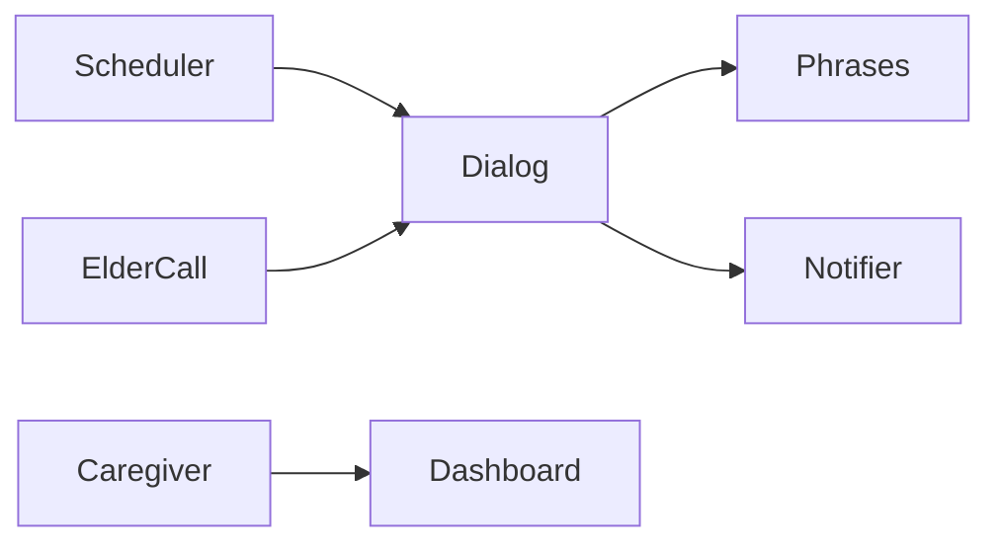

# Saathi Voice — Hindi voice assistant for elders: medication reminders and daily check-ins

[](https://github.com/dnanatihor/saathi-voice/actions/workflows/ci.yml)
[](LICENSE)


TODO: replace docs/demo.gif with a short Hindi reminder MP4 recorded by a person.

## Why

Family caregivers need a Hindi conversation that reminds an elder to take medicine and asks how they are, without a device that interprets symptoms or changes a dose. Saathi repeats only the schedule a caregiver configured, confirms whether the dose was taken, and sends the family a short check-in summary. If the elder signals an emergency, family contacts are alerted immediately.

## Quickstart

```bash
uv run saathi-demo
```

## How it works



A schedule opens a reminder. The elder answers by text, in the browser, or with keypad digit 1 when speech is missing. Spoken lines come only from `src/saathi/dialog/phrases/hi.yaml`.

## Results / example output

Output of `uv run saathi-demo` on 2026-09-30, using `eval/dialogs/reminder_taken.yaml` wording and `eval/utterances.yaml`:

```text
साथी: नमस्ते बाबूजी। मैं साथी हूँ।
साथी: बाबूजी, बीपी की दवा का समय है।
साथी: खाने के बाद
साथी: क्या आपने बीपी की दवा ले ली?
बाबूजी: हाँ, ले ली
साथी: बहुत अच्छा बाबूजी। धन्यवाद।
साथी: ठीक है बाबूजी। अपना ख्याल रखिए।
intent accuracy: 0.60
emergency recall: 1.00
```

The accuracy figure is the offline classifier in CI, not a hosted model. See `docs/adr/0002-speech-providers.md`.

## Design decisions

- [Eval fixtures](docs/adr/0001-eval-fixture-schema.md)
- [Speech providers](docs/adr/0002-speech-providers.md)
- [Consent withdrawal](docs/adr/0003-consent-withdrawal.md)
- [Privacy](docs/privacy.md)
- [Telephony steps](docs/telephony.md)

## Roadmap

- Caregiver interviews, which have not been run, still decide calls versus the app.
- A production speech provider, after live recordings and listener ratings.
- A live telephony provider, after the registration steps in `docs/telephony.md`.

## Licence

Apache-2.0
